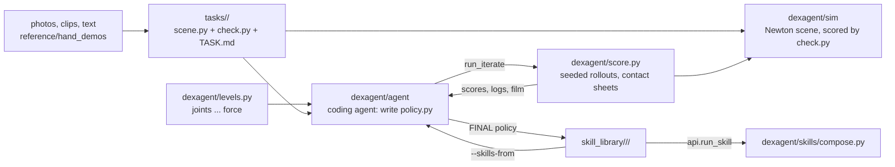

# dexagent

Coding agents that write code to control a dexterous hand. A UR5e arm with a 20-DOF Tesollo DG5F-S hand sits at a table in a GPU simulation (RoboSimStudio: Newton collision, MuJoCo-Warp at 1 kHz, 50 Hz control). A coding agent is forced to use one **action representation** (a *level*), writes `policy.py`, watches simulated rollouts, and improves the code until the task is solved. The paper asks what representation makes that work, whether skills transfer, whether they compose, and how well they hold up.

## Pipeline



## Layout

```
dexagent/
  sim/          workcell (MJCF, IK), scene, hand controller, objects, cases (seeded variation + RQ4 noise), run
  levels.py     the six action representations: joints, fingertips, synergies, contacts, layered, force
  score.py      run a policy on cases (python -m dexagent.score cases ...) and one budgeted agent iteration
  agent/        loop.py (the planner), tools.py, prompt.py, eval.py, openrouter.py, stub.py
  skills/       library.py (save/load solved policies), compose.py (api.run_skill)
  experiments/  rq1_transfer.py  rq2_levels.py  rq3_compose.py  rq4_robust.py
  assets/       robot MJCF and per-task synergy bases
tasks/          hand_demos/ (8, from clips)   inhand/ (4)   composed/ (long-horizon)
scripts/        live (live RoboSimStudio page for one scene), fit_synergies.py
reference/      human demo clips and the HOM paper
results/        experiment runs (untracked)       skill_library/ (untracked)
third-party/    robosimstudio, tesollo_model (submodules); UR5e assets
```

Each task folder holds `scene.py` (scene, seeded variation, expert `routines`), `check.py` (`Monitor` scoring from simulator state only) and `TASK.md` (what the agent reads). A case is `seed:severity`; severity 0 is nominal, 1 is the declared range, above 1 extrapolates.

## Setup

```bash
git clone --recursive <repo-url>        # or: git submodule update --init --recursive
(cd third-party/robosimstudio && UV_PROJECT_ENVIRONMENT=$PWD/../../.venv uv sync --frozen --python 3.12)
uv pip install --python .venv/bin/python -e .
# Drivers older than CUDA 13 (570 / CUDA 12.8) need the cu12 Warp wheel:
uv pip install --python .venv/bin/python "warp-lang @ https://github.com/NVIDIA/warp/releases/download/v1.18.0/warp_lang-1.18.0+cu12-py3-none-manylinux_2_28_x86_64.whl"
uv pip install --python .venv/bin/python pytest ruff      # for the tests
```

Run everything with `export PYTHONPATH=.` and pick the GPU with `CUDA_VISIBLE_DEVICES` (physics and the OVRTX renderer must share it). The agent needs `OPENROUTER_API_KEY`; `--stub dexagent/agent/stub_scripts/*.json` replaces the model with scripted tool calls for offline checks. `pytest` runs the CPU-only tests.

## Core commands

```bash
# film a scene's expert routine
python -m dexagent.sim.run tasks/hand_demos/cube_pinch --camera reference
# score a policy (or the expert) on cases
python -m dexagent.score cases tasks/hand_demos/cube_pinch --policy expert --cases 1:0,2:0.5,3:1
# one coding-agent cell: write policy.py at a forced level, self-improve, held-out test, save the skill
python -m dexagent.agent.loop tasks/hand_demos/cube_pinch --model <slug> --levels contacts --max-iters 4 --library skill_library
```

A cell writes `results/<run>/<task>/<level>/` with `policy.py`, `NOTES.md`, `progress.jsonl`, `usage.jsonl`, `iter_k/` (policy, per-case JSON, contact sheet), `FINAL`, `test/` (held-out, seeds 1000-1007) and `cell_summary.json` (iterations, tokens, cost and wall time to first solve, held-out pass rate).

## Research questions

| RQ | Question | Command | Output |
| --- | --- | --- | --- |
| 1 | Does one learned skill make later skills cheaper or learnable at harder tasks? | `python -m dexagent.experiments.rq1_transfer --order cube_pinch,cube_palm,pen_finger_roll --level layered --model <slug>` | per-task cost to solve, `scratch` vs `library` arm |
| 2 | What effect does the level have on discovery speed, success and cost? | `python -m dexagent.experiments.rq2_levels --tasks cube_pinch,cube_palm --repeats 3 --model <slug>` | per-level solve rate, held-out pass, iterations/tokens/cost to solve |
| 3 | Can isolated skills be strung into a long-horizon policy? | `python -m dexagent.experiments.rq3_compose --library skill_library --skills cube_pinch,cube_palm --level layered --model <slug>` | `chain` (no LLM), `agent` (composes with `api.run_skill`), `scratch` arms on `tasks/composed/pinch_then_palm` |
| 4 | How large is the gap away from the tuning conditions? | `python -m dexagent.experiments.rq4_robust --library skill_library --expert` | pass rate under nominal, in-distribution, extrapolated, noise and latency conditions |

**RQ4 scope.** There is no real-robot code. `rq4_robust` is a simulation proxy for the sim2real gap: it measures degradation under severity beyond 1, joint-target noise and command latency. Real-world transfer and a comparison with graph-as-policy are not implemented. The interface a real deployment would need is a policy `run(api)` over one of the levels; `Controller.step` in `dexagent/sim/hand.py` is the only place joint targets are written.

## Physical contract

A routine or policy writes only the 26 robot joint targets (6 arm, 20 finger). Object poses, velocities and forces are read for planning and scoring and never written. Policies are privileged-state scripts, not perception policies.

## Notes

- Synergy bases (`dexagent/assets/synergies/<task>.npz`) are leave-one-task-out. `pinch_then_palm.npz` is currently a copy of `cube_pinch.npz`; regenerate with `scripts/fit_synergies.py` (see its docstring), which leaves out both component tasks.
- The legacy abstraction study, the online tool-calling agent and the retargeting/teleop/HOM code live on other branches (`retarget-mediapipe`, history before the `paper` branch).
