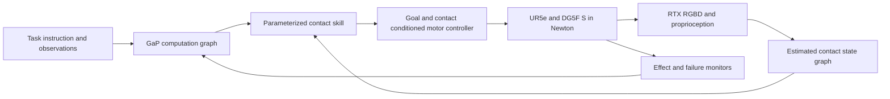

# Action abstractions for industrial dexterity with UR5e and DG5F S

> **Historical.** This note describes the October 12 Newton/GaP prototype, which was removed from the tree. Paths below refer to commit `e460c20`; view them with `git show e460c20:<path>`.

Study date: 10 October 2026. Target: one UR5e carrying a right, 20-DOF Tesollo DG5F-S, Newton physics, RTX observations, and Graph-as-Policy orchestration.

**The strongest research direction is an executable grammar of contact transitions and object effects.** The agent should specify which fingers support an object, which fingers may move, and the motion or force outcome it wants. A feedback controller should realize those instructions through the hand's joints. Start with constrained wrench regrasping and finger-driven nut rotation, then extend the same interface to cable feeding and wrapping.

This is a literature and implementation-feasibility study with a reproducible evaluation protocol. The local asset audit and Newton import check have been run. **There are no measured manipulation success rates yet.** Predicted differences below are hypotheses to test, not experimental results.

The subsequent contact-aware implementation is documented in [the project README](../README.md). It now includes typed finger/contact state, solved-force observations, guarded transitions, GaP tools/checkpoints, and a pending six-method A–F manifest reflecting the requested follow-up protocol. Physical component checks establish contact, maintain it, and release it on the passive nut fixture; these do not establish free-object or industrial benchmark success.

## The research question

For a fixed robot, observation stream, agent, and execution budget, which action representation lets an agent assemble reliable policies for new industrial manipulation instances? Separate three mechanisms:

1. **Controllability:** can the representation express the necessary physical motion?
2. **Interpretability:** can the agent select and parameterize that motion correctly?
3. **Composability:** does completing one action leave conditions that permit the next action, and can execution recover when those conditions fail?

A low-dimensional action space may help optimization while remaining difficult for a language agent to use. Conversely, an intuitive command such as `pinch` can be easy to select but physically incomplete: which fingers, which surface regions, how much force, what friction margin, and what should remain supported during the transition?

The proposed contribution is to measure these mechanisms separately and connect contact-level execution contracts to GaP's typed computation graphs. A grammar by itself, or a library of named dexterous skills, is insufficient as a novelty claim.

## What the existing work changes about the hypothesis

| Evidence | What it establishes | Consequence for this study |
|---|---|---|
| [EigenDEXplore code and method](https://github.com/hgupt3/eigendexplore) | The main method retains joint targets and adds human-motion directions to exploration noise. The repository separately implements eigen-space actions. Packaged bases cover six hands, excluding DG5F-S. | Test PCA actions as an interface baseline. Test EigenDEXplore independently as a way to train the motor controllers, including controllers underneath the grammar. Fit a DG5F-S basis using training data. |
| [SimToolReal](https://simtoolreal.github.io/) | An object-goal policy trained on procedurally generated tools transfers to tool use with in-hand rotations and external interactions. | A generic object-pose controller is an essential strong baseline. Semantic finger instructions must outperform an agent that simply commands the desired tool effect. Its results do not establish nut-threading or cable performance on this hand. |
| [Dexterous Manipulation Graphs](https://arxiv.org/abs/1803.00346) | Graphs can sequence manipulation primitives; the original experiments use a dual-arm system with parallel grippers. | Contact graphs are established prior art. A five-finger, feedback-driven agent interface and controlled industrial evaluation must supply the additional contribution. |
| [Contact Mode Guided Manipulation Planning](https://arxiv.org/abs/2105.14431) and [Autogenerated Manipulation Primitives](https://journals.sagepub.com/doi/10.1177/02783649231170897) | Contact modes can organize continuous motion and discrete contact transitions, including automatically generated primitives. | Base the vocabulary on contact physics rather than an arbitrary list of grasp names. Compare against geometric contact planning where tractable. |
| [Learning the Semantics of Manipulation Action](https://arxiv.org/abs/1512.01525) | Manipulation grammars with explicit syntax and semantics already exist. | Specify how the grammar is grounded in measurable execution conditions and what the GaP agent can do with it that prior semantic parsing does not demonstrate. |
| [DexSkills](https://arxiv.org/abs/2405.03476) | Demonstrated long tasks can be segmented into reusable skills using proprioceptive and tactile information. | Learn skill boundaries and termination detectors from contact events; include a flat learned-skill baseline. |
| [IMCopilot and MoDE-VLA](https://arxiv.org/abs/2603.08122) | RL-trained atomic in-hand skills can be called by a VLA; force and tactile information support contact-aware execution. | Calling learned dexterous primitives from a high-level model is already closely related work. Focus the claim on contracts, composition, recovery, and abstraction comparisons. |
| [Language to Rewards](https://arxiv.org/abs/2306.08647) | Reward parameters can provide a semantic interface between language and optimization, including simulated dexterous tasks. | Consider desired effects or constraints as a flexible alternative to a fixed primitive inventory, especially when the inventory lacks a necessary motion. |

Your concern about eigen coordinates is plausible for agent-facing control, but it does not imply that EigenDEXplore is unsuitable for training. Its exploration mechanism and a contact grammar can be complementary. No cited paper supplies a measured ranking for UR5e plus DG5F-S on these industrial tasks.

## Local feasibility findings

The exact revisions and per-model details are recorded in the asset audit (`study/artifacts/asset_audit.json`).

| Component inspected | Finding | Implication |
|---|---|---|
| `tesollo_model` at `dc8e11d` | Standard DG5F-S has 20 movable joints and no mimic joints; the separate variant has 15. | Use 20 hand joints plus the six arm joints as the main embodiment. Treat 15-DOF transfer as a later experiment. |
| Right mounted hand URDF | 27 links; authored mass approximately 1.1581 kg. All mesh references resolve under the local hand directory. | Account for the full mounted assembly in arm dynamics. These are asset parameters, not calibrated hardware specifications. |
| All eight hand URDF/MJCF pairs | Supplied MJCFs have zero actuator definitions and zero sensor definitions. URDFs provide limits, but those do not specify a complete feedback controller. | Add gains, drive modes, torque/velocity limits, observations, and contact estimation explicitly. Do not assume simulated contacts correspond to installed tactile hardware. |
| Mesh paths | URDFs use `package://meshes/...`. | Resolve these paths explicitly during import; the probe writes a temporary resolved URDF and preserves the originals. |
| Newton CPU asset probe | Mounted hand imported with 20 DOF, 27 bodies, 61 shapes; FK transforms are finite. | Basic import works in the existing Newton environment. Collision quality, dynamics, actuation, and task performance remain unvalidated. |
| `IsaacLab` at `bad20159e` | Newton, OVRTX, and a Franka cable example using MJWarp/VBD proxy coupling are present. | Reuse the backend patterns and cable asset API. Their presence does not validate DG5F-S cable wrapping. |
| `graph-as-policy` at `93e929c` | Connector control paths synthesize arm actions with one gripper channel; observations expose `gripper_fraction`. | Add a named hand-state and action interface. Changing an action dimension alone is insufficient. |
| Execution environment, updated after GPU access was enabled | Eight A100-SXM4-80GB GPUs are visible. GPUs 2, 3, and 7 were idle at inspection. CUDA Newton/MuJoCo-Warp smoke training passes in a local `.venv-newton`; Isaac Lab/OVRTX remain unconfigured. | These GPUs support physics and policy training. A100s lack RT cores and are [not supported for Isaac Sim RTX rendering](https://docs.isaacsim.omniverse.nvidia.com/latest/installation/requirements.html). RTX observations require a suitable renderer host. |

The CPU probe used the Newton checkout already installed from `mind-cable`, rather than the revision pinned by this Isaac Lab checkout. Its full provenance and limitations are in the probe output (`study/artifacts/newton_asset_probe.json`).

The follow-up GPU training package (`dextrain/README.md`) composes the local UR5e and mounted DG5F-S and trains a direction-conditioned nut-rotation motor controller. It uses a passive revolute fixture and state observations, so it is a prerequisite curriculum, not thread tightening or an agent-level abstraction comparison. The CUDA setup uses convex collision hulls, explicit same-body collision filtering, and a 0.5 mm per-shape detection gap. Three-seed training logs and checkpoints are separate from the still-pending benchmark manifest; motor rewards must not be reported as industrial task success rates.

The finger numbering must be mapped to logical thumb/index/middle/ring/little roles after visual FK inspection. Do not infer that `joint_1_*` necessarily denotes the thumb. The UR5e flange-to-hand transform also needs an explicit mount definition and validation; a mounted hand asset alone is not an assembled UR5e-hand robot.

## Action representations to compare

Every method uses the same arm goal interface and actuator limits. Hand representation, temporal abstraction, controller training, and agent prompting are recorded separately.

| Interface | What the agent commands | Expected advantage | Likely limitation |
|---|---|---|---|
| Joint increments | Twenty normalized hand increments | Broad local expressivity and a useful diagnostic baseline | High-dimensional search; joint coordinates carry little task meaning |
| PCA posture coordinates | Six coefficients initially; sweep rank later | Compact, coordinated postures | Grasp variance need not preserve rare release, opposition, or gait transitions; linear coordinates have no stable task semantics |
| Learned latent skills | Eight continuous latent coordinates, initially | Can represent dynamic motion and nonlinear coordination | The agent must learn the meaning of the latent coordinates; coverage is limited by training |
| Fingertip goals | Palm-frame tip motions and contact-force targets | Geometric meaning and fine local control | Can request incompatible contacts; 15 position channels alone are not especially compact; inverse kinematics does not guarantee grasp stability |
| Object goals | Object pose/twist or local shape-effect goals | Directly expresses the task outcome; strong tool-use baseline | May hide the need to change support contacts or expose diagnostic failure state poorly |
| Flat semantic primitives | Named, parameterized pinching, rolling, sliding, regrasping, feeding | Easy to describe and compose informally | Correct primitives can still be called in the wrong order or from unsupported states |
| Contact grammar | The same primitives plus typed roles, preconditions, invariants, and postconditions | Explicit dependencies, concurrency rules, recovery, and traceable failures | Depends on contact-state estimation and controller coverage; an overly strict grammar may reject feasible behavior |
| Grammar with residual control | Contact grammar plus bounded learned corrections | Adapts to geometric and dynamic variation | Added motor capacity can confound attribution; unconstrained residuals can violate the intended contacts |

**Predictions:** object goals may win on simple rigid-tool pose tracking. Flat primitives may be sufficient for short, familiar sequences. Grammar should help most when a task requires repeated support transfers, interrupted execution, and reuse of known motions in unseen orders. Residual control may help under geometric or friction variation. PCA may be entirely adequate for grasp acquisition while failing to express rare contact transitions. These predictions should be rejected if matched experiments do not support them.

Do not present dimensionality as the sole explanatory variable. An interface with more parameters can be easier for the agent if the parameters have consistent geometric meaning. Likewise, reducing the number of agent decisions can improve success independently of semantics.

## The proposed contact grammar

Use a hybrid representation: discrete contact structure plus continuous effect parameters. For each action, define:

- **Roles:** supporting fingers, moving fingers, object or cable segment, and any permitted fixture contact.
- **Preconditions:** currently observed support state, reachable target patch, and a task-specific feasibility estimate.
- **Desired effect:** object-relative translation/rotation, cable feed distance, or force/tension change, in a named coordinate frame.
- **Invariants:** required support contacts, allowed slip, actuator bounds, and clearance or tension constraints.
- **Termination:** measurable target attainment sustained for a specified interval, or a typed failure.

A conceptual instruction could be:

```text
RELOCATE(index, target_patch=handle_patch_7)
    WHILE MAINTAIN(thumb, ring, little)
    REQUIRE feasible_support_and_reachability
    UNTIL target_contact_is_stable
    ON lost_support -> restore_support_or_abort
```

This is illustrative syntax, not an executable GaP node. Three fingers in contact do not prove force closure. A support predicate must use geometry, friction, wrench demand, uncertainty, and the controller's validated operating region. Type checking verifies structural consistency; it does not certify contact dynamics.

The initial vocabulary should cover `acquire_contact`, `maintain_contact`, `release_contact`, `slide_contact`, `roll_object`, `pivot_object`, `relocate_finger`, and `transfer_support`. Cable execution adds `feed_segment` and a constrained wrapping motion; fastening adds an engaged turn with a measurable angle/advance relation. Grasp labels such as pinch, tripod, and power grasp serve as initialization templates, not complete manipulation programs.

Support concurrent finger roles explicitly. A single UR5e does not supply a second hand: an anchor must come from another finger group or a modeled fixture. Concurrent actions require compatible finger assignments and a shared force budget. A simple sequence of whole-hand postures cannot express this distinction reliably.

Two different graphs are involved:



The contact-state graph describes the physical relationships among fingers, objects, cable segments, and fixtures. GaP's computation graph chooses skills, handles data dependencies, and branches on outcomes. The grammar maps admissible contact transitions into executable skill calls; it does not replace GaP's runtime graph.

Use a fast feedback controller beneath event-driven agent decisions. Initial tuning candidates are 50–200 Hz motor control and 0.5–2 ms physics steps, subject to convergence and throughput measurements. The agent acts at skill boundaries and failures; it is not responsible for servo timing. A learned policy can output all twenty hand targets while being conditioned on a small semantic command.

For a residual variant, constrain corrections to joint limits and the action's contact requirements. Evaluate contract violations directly. A clipped additive residual alone does not preserve support.

Train the motor layer as goal-conditioned options: each option has an admissible starting-state distribution, a feedback policy, and a termination detector. Sample object geometry, contact locations, desired effects, and modest disturbances within that distribution. Reward achieved object motion and support preservation, while enforcing actuator and collision constraints. Begin with grasp maintenance and small rotations, then add finger relocation and support transfer. Retargeted demonstrations can initialize difficult transitions; count that data in every relevant comparison.

Estimate the reachable effect set and failure probability for each option from held-out executions. A grammar guard can then combine a geometric feasibility check with an empirically calibrated competence estimate. Training every option only from one canonical grasp would create a misleading skill library: successful endpoints must overlap the admissible starting regions of subsequent skills. Test those transitions directly, including recovery transitions, before asking the agent to synthesize long programs.

Use distinct types for rigid-object pose goals, cable material-segment goals, and engaged-fastener goals. Reusing the same skill vocabulary does not imply that a cable has one meaningful rigid pose or that a free nut and an engaged nut obey the same dynamics.

## Industrial task suite

The initial suite should isolate manipulation within the hand from ordinary arm transport. For every task, log object motion relative to the palm, contact transitions, arm motion, and all external support contacts.

| Task | Required dexterity | Task endpoint and constraints | Held-out variation |
|---|---|---|---|
| Wrench acquisition and regrasping | Pick a thin wrench from a tray, change its orientation or grip location within the hand, engage a fastener, and repeat loaded turns in restricted space | Required palm-relative reorientation and regrasp stages, actual fastener rotation against load, no drop or forbidden set-down, and bounded wrench/fastener slip | Handle thickness, mass distribution, jaw geometry, initial grip, clearance, and required turn sequence |
| Finger-driven nut spinning | Alternate finger contacts while advancing a nut on a fixed stud | Target nut angle and axial advance agree with pitch; bounded wrist rotation forces finger motion; final engagement held without jamming | Nut size, thread pitch, friction, initial phase, and interrupted turn sequence |
| Cable feeding and wrapping | Anchor with one finger group while feeding or wrapping with another; repeatedly transfer support | Required wraps and endpoint retention, bounded tension/curvature, no cable interpenetration, and final shape maintained | Cable length, diameter, bending/torsional response, friction, initial geometry, and wrap direction/order |
| Later transfer tasks | Reorient a keyed connector and insert it, rotate a collet, manipulate a retaining clip | Task-specific engagement or retention, with permitted supports specified | New combinations of previously trained effects and contact transitions |

Start nut spinning **already engaged**. That tests in-hand rotation without making thread capture a hidden confound. Add thread acquisition and misalignment recovery as a separate harder task. For wrench operation, ensure the fixture and required palm-relative regrasp actually demand dexterity: many ordinary wrench operations can be solved by an arm with a fixed grasp. Include that fixed-grasp baseline to expose an insufficiently challenging task.

For cable wrapping, distinguish wrapping around the fingers from wrapping around an external mandrel. They have different contact topology and support requirements. Start with an anchored cable and a specified finger group or mandrel; reserve an entirely free cable for a later benchmark. Record cable material coordinates so `feed 20 mm` denotes movement along the cable, not just translation of its center of mass.

Freeze numeric tolerances after calibrating the assets and before comparing methods. Candidate pilot targets include a prescribed 90-degree palm-relative wrench reorientation, multiple regrasp cycles, one full nut revolution, and one or two cable wraps. These targets are provisional; fixture geometry must first establish their feasibility. Success thresholds must include dwell time and task-effect checks, not only reward thresholds or a visual judge.

## Newton and RTX implementation

Use the local Isaac Lab backend architecture, with **Newton MJWarp for the rigid arm, hand, and tools, and OVRTX for camera observations**. Current renderer documentation distinguishes policy cameras from interactive visualizers; selecting an RTX viewer alone does not establish the agent's observation pipeline. [Isaac Lab rendering documentation](https://isaac-sim.github.io/IsaacLab/develop/source/how-to/configure_rendering.html)

After installing the renderer dependencies, a bounded camera smoke check using the local CLI is:

```bash
cd /home/uyoo/Projects/dexagent/third-party/IsaacLab
uv run --extra ovrtx isaaclab zero_agent \
  --task Isaac-Cartpole-Camera --num_envs 1 --max_steps 100 \
  physics=newton_mjwarp renderer=ovrtx presets=rgb
```

This is an upstream installation check, not a dexterous environment or a command run in this study. The checkout requires Python 3.12, pins a Newton commit, and declares an `ovrtx` extra. Follow its installation instructions to build a dedicated environment; mixing its pins into the existing `mind-cable` environment would make the evidence difficult to reproduce.

The local Franka cable configuration (`IsaacLab/source/isaaclab_tasks/isaaclab_tasks/core/lift/config/franka_soft/franka_cable_env_cfg.py`) supplies an MJWarp/VBD coupling example. Replace its robot-specific proxy bodies with the hand surfaces that can touch the cable, including palm and intermediate phalanges where appropriate. Validate reaction-force transfer and coupling delay; the installed Newton proxy implementation uses lagged-impulse feedback. The example's high friction setting and coarse cable discretization should not become uncalibrated industrial defaults.

Newton is a multi-solver framework. Joint, contact, and deformable support depend on the selected solver and version. Pin those choices per experiment; repeat numerical sensitivity checks before interpreting task differences. [Newton solver documentation](https://newton-physics.github.io/newton/stable/solvers/index.html)

Four physics gates precede the main comparison:

1. **Robot and contacts:** assembled UR5e/hand FK, mount pose, joint limits, collision filtering, actuator response, fingertip contact patches, sliding friction, and stable grasp under load. Keep necessary nonadjacent self-collisions; avoid blanket hand self-collision disabling.
2. **Fastening:** a pitch-constrained screw model may support an early nut-spinning task, but it cannot establish thread capture or cross-threading competence. Prevent off-axis and unengaged states from receiving artificial axial advance. Validate loaded contact geometry for wrench turning separately.
3. **Cable:** test bending, twisting, tension, frictional slip, knot/wrap retention, and self-contact. Check finer segment resolution and half-sized timesteps. Monitor penetration and coupling artifacts rather than trusting visually plausible motion.
4. **Observations:** verify synchronized RTX images, camera calibration, lighting, occlusion, and depth conventions. Separate exact simulator contact state from noisy estimated contacts. Visual fidelity does not establish physical fidelity.

Use oracle object/contact state first to isolate action representation. Then repeat selected methods with RTX RGB-D and proprioception, and with contact estimates when sensors support them. Keep the observation regime identical within each comparison. Avoid giving the grammar exact contact labels while the baseline receives only images.

## Integration with Graph as Policy

The relevant local seams are [connector control](../../graph-as-policy/gap/connector/core.py), [typed observations](../../graph-as-policy/gap-core/src/gap_core/types.py), and [learned-policy skills](../../graph-as-policy/gap/runtime/policy_skill.py). The existing [UR cable example](../../graph-as-policy/examples/cable_ur/README.md) is perception-only; it is not a manipulation backend.

Propose a separate Newton dexterity connector and a skill bundle before generalizing the existing connector:

- Add a `HandState` containing named joint positions/velocities, palm and fingertip poses, contact estimates, their confidence, and timestamps. Preserve explicit units and frames.
- Represent a `DexterityCommand` with skill type, object reference, role assignment, continuous goal parameters, and execution bounds. Return achieved effect and typed failure, such as `lost_support`, `unreachable_patch`, `excess_slip`, `jammed`, or `timeout`.
- Provide a simulation process boundary between GaP and the Newton/RTX environment. This isolates simulator dependencies and lets the feedback loop continue independently of LLM latency.
- Register supported dexterous skills through GaP's existing bundle/tool conventions. Reuse graph checkpoints and recovery branches, but supply contact-aware termination instead of interpreting the last action entry as a scalar gripper.
- Trace the requested effect, selected contacts, controller checkpoint, observations, and failure cause. Convert quaternion conventions explicitly: GaP uses scalar-first `wxyz`; the Newton probe records transforms with `xyzw` rotations.

Two development tracks should remain visible: learning reusable motor skills, and enabling the agent to compose them. The latter is the primary contribution to GaP; failure in the former must not be attributed to the grammar.

## Experimental design and attribution

The primary contrast is **contact grammar versus flat primitives with exactly the same trained primitive checkpoints**. Match names, continuous parameters, skill execution horizons, observations, agent model, examples, token budget, graph-revision budget, recovery budget, and actuator limits. The treatment is explicit contact-role contracts and the corresponding composition/monitoring logic. Keep basic actuator-limit enforcement common to all methods.

Run two complementary evaluations:

1. **Controller reachability and reliability:** a scripted expert or trajectory optimizer chooses commands. Measure whether each abstraction can realize required effects from controlled initial states. This estimates the motor/interface ceiling independently of the language agent.
2. **Agent planning and execution:** the same GaP agent generates and revises a policy using each interface, then runs it on held-out cases. Measure initial graph success and success after a fixed repair budget separately.

The broad eight-interface comparison estimates complete-system performance. It cannot fully isolate semantics when controllers, dimensionality, and training differ. Report equal training compute, equal demonstration data, and each controller's competence separately. The matched flat-versus-grammar experiment provides the cleaner causal evidence.

Use three distinct generalization splits:

- **IID:** new initial conditions drawn from the training distribution.
- **Geometry:** unseen object instances and shape families; fit PCA, latent models, geometry encoders, and controller curricula only on training assets.
- **Composition:** held-out sequences, support-role combinations, turn directions, and recovery situations built from known primitives. Split graph templates and demonstrations to prevent sequence leakage.

Add dynamics perturbations and contact-estimation noise as separate sweeps. Do not pool them with geometry or composition when reporting the main ranking. Parameterize perturbation severity so improvements can be plotted against difficulty instead of summarized by one average.

The machine-readable protocol (`study/protocol.json`) proposes:

| Stage | Methods | Tasks | Splits | Training seeds | Cases per cell | Episodes |
|---|---:|---:|---:|---:|---:|---:|
| Pilot | 4 | 2 | 2 | 3 | 20 | 960 |
| Main comparison | 8 | 3 | 3 | 5 | 100 | 36,000 |

These are evaluation counts, not training steps or an estimate of required GPU hours. The pilot includes object goals, flat primitives, contact grammar, and grammar with residuals on wrench and nut tasks. The main comparison adds all interfaces and cable wrapping. Generate shared physical cases across methods and training seeds; randomize method execution order. Each sequence perturbation must also be shared within the paired case.

The manifest is deliberately pending. Before running it, supply the assembled robot, calibrated task physics, checkpoints, frozen numerical success rules, versioned case assets, agent configuration, and GPU runtime. No results are generated from method labels or predicted rankings.

For training exploration, compare IID noise against EigenDEXplore on a small matched set of motor-skill learners. Then hold the resulting checkpoint bank fixed for the primary interface comparison. This prevents the exploration method from being conflated with agent-facing semantics. Count controller retraining and primitive annotation in total development cost.

## Metrics and statistical analysis

**Primary endpoint:** probability of completing the entire task within the fixed simulation-time and recovery budget, with all physical success constraints satisfied. Dropped objects, jams, timeouts, and illegal support are failures, not missing observations. Infrastructure failures must be logged and rerun under the same case ID with attempt provenance.

| Question | Measurements |
|---|---|
| Can the interface express the task? | Expert-commanded effect attainment, reachable goal coverage, clipping, and infeasible-command rate |
| Does the agent use it well? | Full-task success, first-graph success, graph repair attempts, rejected or invalid actions, semantic parameter errors |
| Does composition help? | Success versus sequence length, support-transfer count, held-out composition success, contract violations |
| Does execution recover? | Recovery success conditional on a standardized disturbance, recovery time, repeated failure types |
| Is it industrially useful? | Cycle time, tool slip, nut advance/torque consistency, cable tension and curvature excursions, drops and jams |
| What does it cost? | LLM calls/tokens, measured wall-clock latency, controller GPU hours, demonstration hours, throughput, and memory |

Report simulation time and wall-clock time separately. Report cycle time conditional on success alongside unconditional timeout-aware completion curves; otherwise a method that fails difficult cases may appear artificially fast. Measure palm-relative object motion and contact changes so arm motion cannot stand in for dexterity.

Aggregate success within each independently trained seed, then report seed-level rates and paired differences. The included analysis resamples matched training seeds and test cases as crossed factors, and rejects mismatched or incomplete planned comparison grids. Five seeds are a starting point, not a power guarantee. With only three pilot seeds, intervals are exploratory. If test cases share object families, use family-level resampling in the final paper; the current script assumes cases are independent and does not implement that extension.

Pre-register flat-versus-grammar on held-out composition as the primary comparison. Treat additional method rankings as exploratory or apply a multiple-comparison correction. Use pilot variance and paired discordance to set the main sample size for a practically meaningful effect; do not infer significance from a nominal 100 episodes alone.

Recommended figures are paired success differences with intervals, success versus required support transitions, performance under contact-estimation noise, and success versus total training/agent cost. A failure taxonomy should distinguish perception, planning, motor execution, and physics-model errors.

## Ablations that would make the contribution convincing

| Ablation | Confound or hypothesis tested |
|---|---|
| Same primitive bank with and without contracts | Contribution of explicit composition and monitoring |
| Opaque labels and matched learned examples versus semantic descriptions | Contribution of agent-readable meaning rather than controller capacity |
| Preconditions only, then invariants, then recovery | Which part of the grammar improves performance |
| Same grammar with oracle contacts and progressively noisy contacts | Sensitivity to grounding errors and overconfident guards |
| Object effects only versus effects plus contact roles | Whether explicit finger roles add value beyond a strong goal-conditioned controller |
| Fixed versus matched adaptive horizons | Whether temporal abstraction explains the gain |
| Fixed-grasp arm baseline | Whether the industrial task actually requires in-hand dexterity |
| Residual disabled, enabled, and constrained | Robustness benefit and any cost in contract violations |
| PCA rank and nonlinear latent dimension sweeps | Loss of expressivity versus loss of semantic interpretability |
| IID versus EigenDEXplore motor training | Benefit of structured exploration beneath the same agent interface |

Do not evaluate only successful demonstrations or let the grammar have hand-written task macros unavailable to the flat baseline. In particular, a `tighten_nut` macro that implements the complete task would erase the abstraction question. Primitive boundaries should reflect reusable contact events across tasks.

## Execution order and decision criteria

1. **Asset and runtime gate:** compose UR5e with the mounted hand, validate collision/actuator behavior, and obtain synchronized Newton/RTX observations. The supplied probe closes only the hand-import part of this gate.
2. **Rigid-object controller gate:** establish stable grasp, object rotation, and individual finger relocation from randomized admissible starting states. Report each skill's reliability and operating region.
3. **First informative comparison:** freeze a shared primitive bank and run the 960-episode pilot. Evaluate whether contract failures predict actual execution failures and whether grammar improves held-out composition at matched cost.
4. **Cable gate:** validate cable physics and train local feeding/support-transfer skills before testing complete wrapping. Repeat numerical sensitivity checks on the hardest contact conditions.
5. **Main study and contribution:** run broader interfaces and sensing regimes; contribute the hand interface, Newton connector, skill contracts, industrial task assets, and paired evaluation tools to the GaP direction.

If grammar improves only syntax validity, but not physical task success or recovery, the main hypothesis is unsupported. If object goals achieve similar success at lower training and agent cost, prefer them for that task family. If grammar helps only with oracle contact state, the result is a contact-grounding research problem rather than a deployable agent advantage. If cable performance changes materially with discretization or solver settings, resolve that before attributing differences to action abstraction.

The most defensible paper claim would be: **contact-effect contracts improve agent composition and recovery for industrial in-hand manipulation, measured against matched motor skills and strong object-goal control.** That claim remains conditional on the experiments above.
